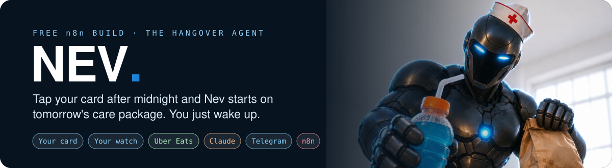
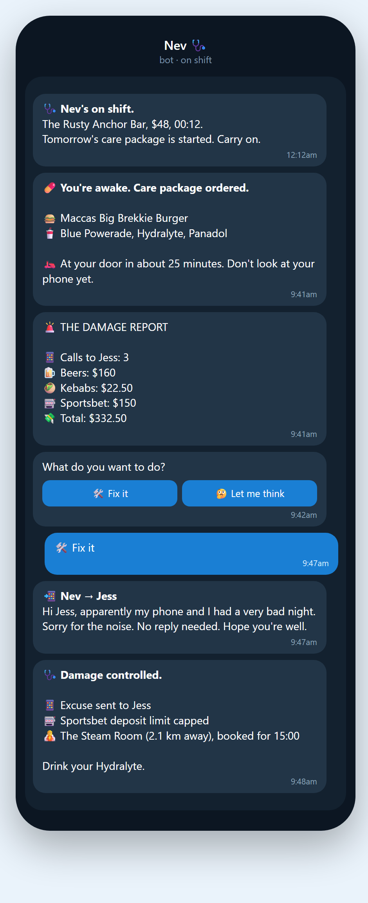
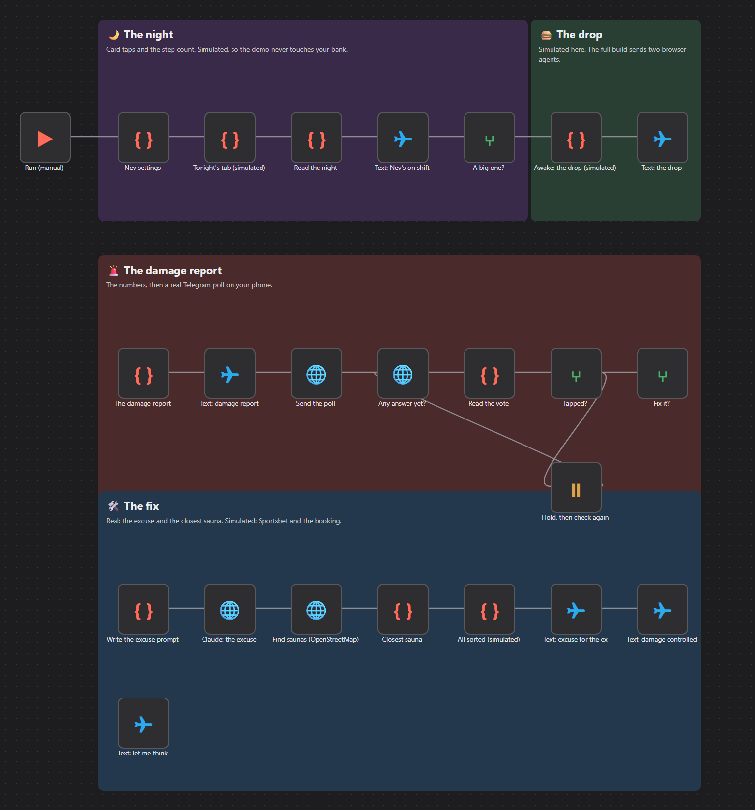

<p align="center">
  
</p>

<h3 align="center">Your hangover, handled before you've found your phone.</h3>

<p align="center">
  <a href="https://github.com/aaronparton2-sketch/nev/releases/latest/download/nev.zip"></a>
</p>
<p align="center"><sub>No GitHub account needed. No coding. About 10 minutes.</sub></p>

---

## Set it up in 3 steps

**This page is just where the file lives.** Your AI does the hard part.

| | |
|:-:|:--|
| **1** | Click the blue **Download Nev** button above. You'll get a file called `nev.zip`. Don't open it. |
| **2** | Open [ChatGPT](https://chatgpt.com) or [Claude](https://claude.ai). Drag `nev.zip` into the chat, then paste the message below. |
| **3** | Follow along. It gives you one step at a time. When you're done, your phone gets the whole morning-after in one click. |

**The message to paste:**

```text
I've uploaded Nev, a free n8n automation. I have never used n8n or GitHub and I can't code. Read SETUP-GUIDE.md in this zip, then set up the DEMO with me. Give me one step at a time, tell me exactly what to click, and wait for me to say done. If I get stuck, ask me for a screenshot.
```

---

## What Nev sends you

<p align="center">
  
</p>

---

## The night, step by step

| | Nev... | In plain English |
|:-:|---|---|
| 💳 | **clocks on** | Tap your card at a bar after midnight and he starts tomorrow's care package. |
| 👟 | **watches the night** | Every round, every Uber, and your steps between 12 and 2am. Bar after midnight plus a huge step count means it's a big one. |
| 🍔 | **sorts the drop** | The second you wake up: a brekky burger, blue Powerade, Hydralyte and Panadol, ordered from your own Uber Eats. |
| 🚨 | **rips the bandaid off** | The damage report. How many times you tried your ex, and what you spent on beers, kebabs and Sportsbet. |
| 🛠️ | **gives you one choice** | A Telegram poll: Fix it, or Let me think. |
| 🧖 | **fixes it** | Tap damage control: an excuse for your ex, your Sportsbet limit as low as it'll go, and the closest sauna booked for the afternoon. |

---

## How Nev does the "impossible" bits

Most of these apps don't let automations in. Here's the honest workaround for each.

| The problem | The workaround |
|---|---|
| **Your bank won't share your card taps** | An iPhone Wallet automation tells Nev the moment you tap. With Up Bank, its free developer access does the same. |
| **Uber Eats has no ordering API** | A browser agent opens your own Uber Eats account and orders the way you would. If it can't finish, you get a link to tap instead. |
| **Burgers and Panadol are different stores** | Nev places two orders, one for each store, each with a spending cap. |
| **Apps can't see your phone calls** | Save a cheap Twilio number as your ex's contact. Your call connects as normal and Nev adds one to the count. He never records anything. |
| **Sportsbet has no API** | Another browser agent uses your account's deposit limit page. It's only allowed to lower a limit, never raise one, deposit or bet. |
| **Saunas have no booking API** | Google Maps finds the closest one, and a browser agent books it on their own site. If it can't, the time goes in your calendar with a link. |

<details>
<summary><b>The demo vs the real thing (click to open)</b></summary>

<br>

**The demo** runs the whole morning in one click and costs about 1 cent. Claude's report, the excuse, the buttons on your phone and the closest sauna are real. Your bank, your watch, Uber Eats, Sportsbet and the booking are simulated, so nothing gets bought.

**The full build** does it for real, and `SETUP-GUIDE.md` covers every step. It needs an iPhone or an Up Bank account, a Browser Use account, and a Google Maps key. Nothing spends without a limit you set, and nothing in the fix runs until you tap.

**Worth knowing before you go live:**
- Browser agents aren't a supported way to use Uber Eats or Sportsbet, and their terms may not allow it. It could get your account restricted, so that's your call. The agent stops at any login, code or security check. It won't try to get around them.
- Log in and pick your saved card and address yourself. Never give an AI your passwords or card numbers.
- If your ex has asked you not to contact them, delete the ex steps. The excuse is only a draft for you unless you turn on sending.

</details>

<p align="center">
  
</p>

---

## Questions people ask

<details><summary><b>Do I need to know how to code?</b></summary><br>No. Your AI walks you through it, and you click what it tells you.</details>
<details><summary><b>What's n8n?</b></summary><br>The app that runs the automation. Think of it as the place Nev lives. There's a free trial at <a href="https://n8n.io/">n8n.io</a>.</details>
<details><summary><b>What does it cost?</b></summary><br>Nev's free. The demo costs about 1 cent of Claude. The full build costs a few cents a morning, plus the browser agent runs and whatever you order, each capped in the settings.</details>
<details><summary><b>Will it order food every morning?</b></summary><br>No. Only after a bar tap after midnight AND a big step count between 12 and 2am. Once per night.</details>
<details><summary><b>I'm stuck.</b></summary><br>Screenshot it and show ChatGPT or Claude. Still stuck? Message <a href="https://www.instagram.com/aaronautomates/">@aaronautomates</a> on Instagram.</details>

---

<p align="center"><sub>Free under the MIT licence. Built by <a href="https://myceliumai.com.au">Mycelium AI</a> in Perth · more builds at <a href="https://aaronautomates.com.au">aaronautomates.com.au</a> · <a href="https://www.youtube.com/@aaron-parton">YouTube</a><br>
Not affiliated with Uber Eats, Sportsbet or anyone else named here. Nev's a joke with real code, not medical advice: follow the label on anything you take.<br>
If gambling has stopped being fun, Gambling Help is free and open 24/7 on 1800 858 858.</sub></p>
